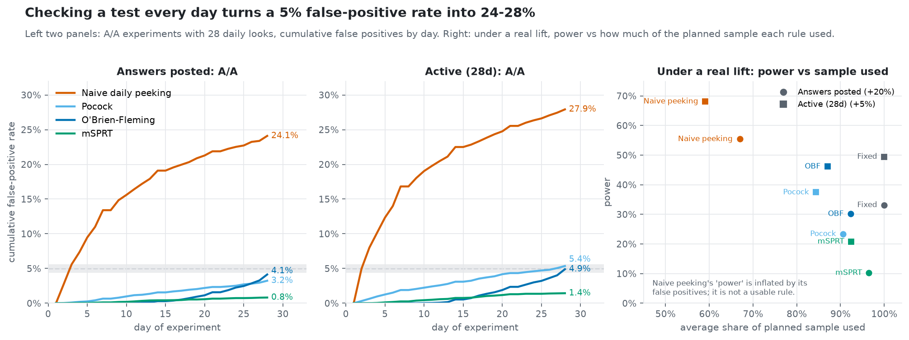

# ExpKit

[](https://github.com/himanshmunjal/Expkit/actions/workflows/ci.yml)


An A/B-testing toolkit (CUPED, delta-method ratio metrics, SRM checks, alpha-spending and
mSPRT sequential tests, power/MDE) that is **validated, not assumed**: thousands of A/A tests
and known-lift injections on real Stack Overflow user behaviour.

> **Semi-synthetic by design.** User behaviour is real (BigQuery public Stack Overflow data).
> Assignment and effects are simulated. Results are claims about *methodology*
> (calibration, power, variance reduction), never about business lift.

## Headline results

Real Stack Overflow behaviour (177,441 users; T0 = 2022-08-22; 28-day outcome window), with
simulated assignment and effects. Full tables are in `results/`; the reasoning is in
DECISION.md D-048 to D-054.

| Finding | Result |
|---|---|
| A/A false-positive rate (nominal 5%), Welch, n = 10k/arm | **4.98%** (answers), 4.84% (comments), 5.04% (active) |
| Small samples, heavy tails (n = 100/arm) | Welch **2.3%** (conservative); percentile bootstrap **8.5%** (anti-conservative) |
| CUPED variance reduction (theory ρ² → observed) | answers **61.6% → 62.9%**; comments **73.5% → 74.0%**; active 3.0% → 3.7% |
| Ratio metric A/A FPR at n = 100 / 1,000 / 10k | delta **20.6% / 10.4% / 6.1%** → jackknife (new default) **5.9% / 6.4% / 5.5%** |
| Naive per-user ratio | calibrated, but **+18% biased** for the ratio-of-sums effect |
| Daily peeking over 28 looks (A/A) | naive **24–28%**; O'Brien-Fleming **4.1–4.9%**; Pocock 3.2–5.4%; mSPRT ≤ 1.4% |
| Power kept vs fixed horizon | OBF **91–93%**; mSPRT (τ = 3 SE) 31–42% |
| 20 metrics, no true effect: family-wise error | none **62.7%**; Holm 6.0%; BH 6.3% |
| Capping vs CUPED, +20% lift at 20k/arm | CUPED 92% power, −1.5% bias; capping at p99 91% power, **−56% bias, 2% CI coverage** |
| SRM check (p < 0.001), 20k users | catches a 5% loss of treatment users **61%** of the time, a 2% loss **3%** |
| Detectability (80% power, CUPED) | `answers_posted`: **~15% lift at 20k/arm**, ~7% with every user (~89k/arm; 7.5% at the 80k/arm the readouts use) |

**Scale and checks (verified 2026-10-25, D-058):** 13 registered methods; ~229K simulated experiments (626K method-level tests) across eight studies (every `results/` file reproduces byte-for-byte from the seeds); 115 tests passing at 91% line coverage; `ruff` clean.

The four [example readouts](docs/example_readouts/) each run 200 draws and state how often
the rules reach the intended decision: ship 96%, well-powered null 94%, inconclusive 88%,
SRM-invalid 100%.



*Checking an A/A test every day for 28 days. The naive test's false-positive rate climbs to
24–28%, while O'Brien-Fleming stays under 5%. All nine charts are explained in
[docs/REPORT.md](docs/REPORT.md).*

## Quick start

```bash
pip install -e ".[all,dev]"
make test                         # unit + property + statistical tests
make experiments-quick            # every experiment end-to-end on synthetic data

# real data (needs gcloud auth application-default login)
make verify                       # choose T0 from table freshness
make extract                      # T0 defaults to 2022-08-22 (data ends 2022-09-25)
make profile && make experiments JOBS=-1 && make readouts && make report   # report also builds the figures
```

## Project layout

```
src/expkit/     the library: stats/, sequential/, assign/, effects/, sim/, report/, viz/,
                plus the method registry, CLI (cli.py) and REST API (server.py)
experiments/    the eight validation studies (A/A, CUPED, ratio, peeking, SRM, ...) + readouts
data/           BigQuery SQL (verify.sql, extract.sql) and per-user preparation
results/        summary CSVs and raw parquet from every study (synthetic runs in results/synthetic/)
docs/           validation report, figures, example readouts, decision framework
app/            Streamlit app
tests/          unit, property and statistical tests (run in CI on Python 3.11 and 3.12)
```

## Use it from anywhere

```python
from expkit import ExperimentConfig, analyze
readout = analyze(df, ExperimentConfig.from_toml("configs/example_experiment.toml"))
print(readout.decision, readout.to_markdown())
```

```bash
expkit power --baseline-mean 1.0 --sd 3.0 --mde 0.03 --relative --variance-reduction 0.4
expkit analyze --data exp.parquet --config configs/example_experiment.toml --format json
expkit methods
uvicorn expkit.server:app        # POST /analyze, /test, /power; GET /methods
streamlit run app/streamlit_app.py
```

To add a method, register it once and it appears in the CLI, API, app and simulation harness:

```python
from expkit import registry
@registry.register("my_test", kinds=("mean",))
def my_test(control, treatment, *, alpha, rng, **opts): ...
```

## Docs
- **[docs/REPORT.md](docs/REPORT.md): the validation report, with nine charts and what each one shows** (one-page web version: `make report` → `docs/report.html`)
- [DECISION.md](DECISION.md): every architecture and methodology decision, with rationale
- [FLOW.md](FLOW.md): run order, call flow, file-creation order, study order
- [docs/decision_framework.md](docs/decision_framework.md): ship / hold / extend rules
- [docs/example_readouts/](docs/example_readouts/): four worked readouts (clear win, well-powered null, inconclusive, SRM failure)

## License

MIT
