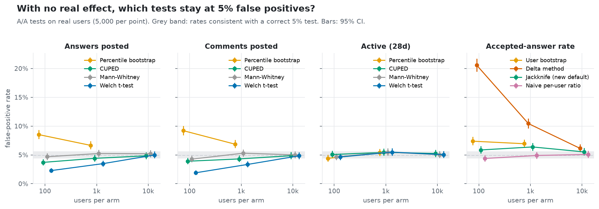
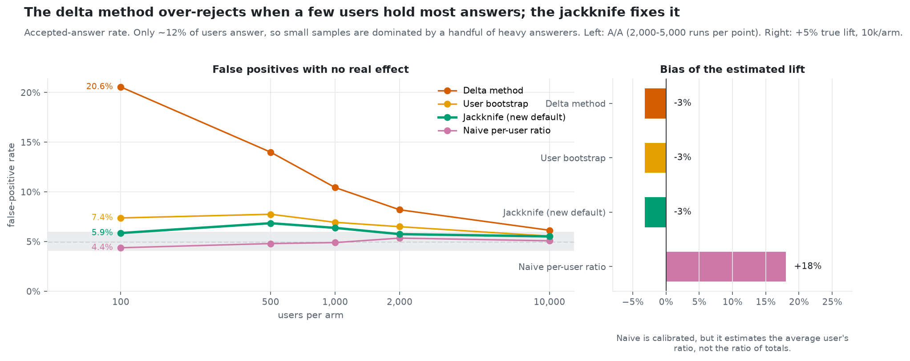
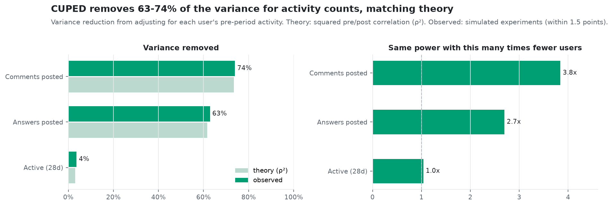
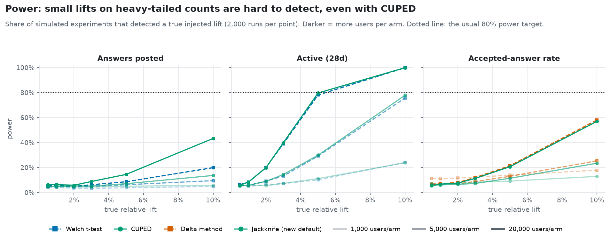
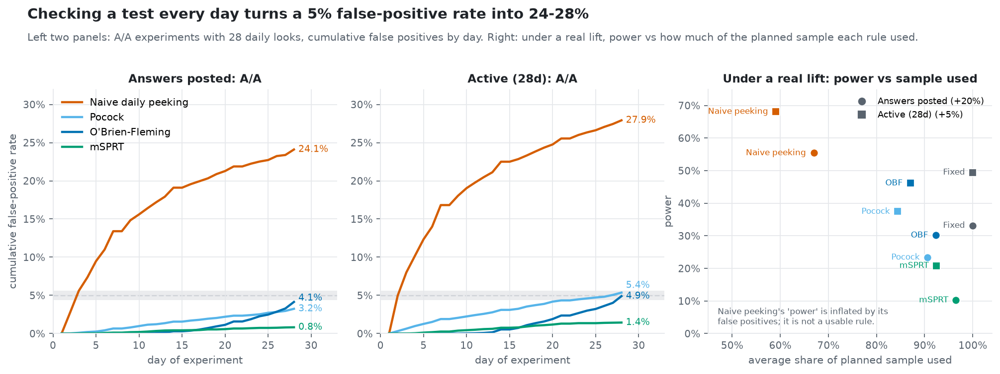
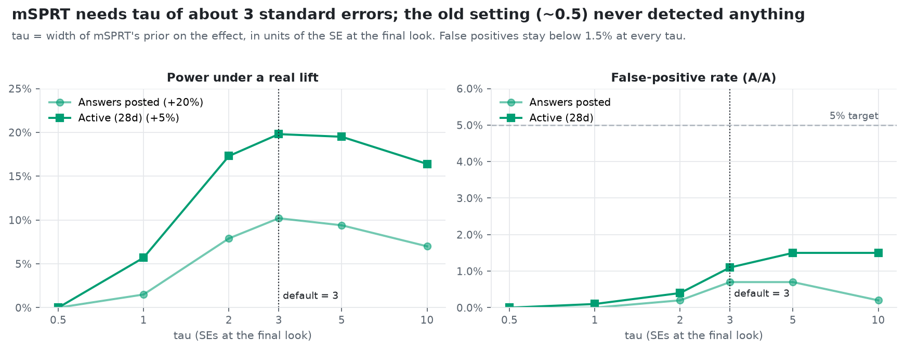
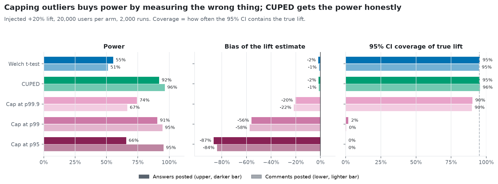
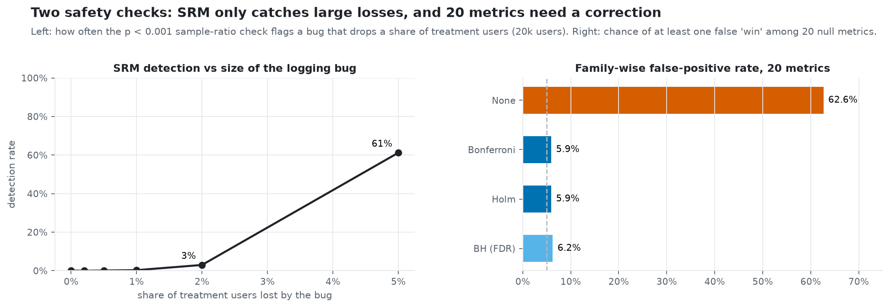
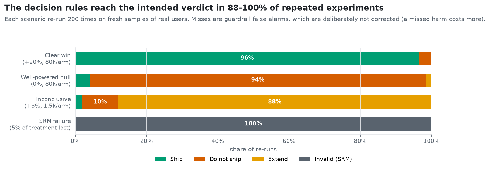

# ExpKit validation report

**Which A/B-testing methods can you trust on real, heavy-tailed user behaviour, and when do they fail?**

ExpKit is an experimentation toolkit (CUPED, ratio metrics, SRM checks, sequential testing, power,
multiple-testing control and a ship/no-ship decision engine). This report checks the methods
against what actually happens in simulated experiments on real user behaviour, so that each
method is validated before it is trusted.

> **Scope.** The user behaviour is real: 177,441 Stack Overflow users from the BigQuery public
> dataset. The assignment to groups and the treatment effects are simulated, so the true answer
> is always known. Every number here is a claim about **methods**, never about a product change.

---

## Outcomes at a glance

| # | Outcome | Evidence |
|---|---|---|
| 1 | **The delta method was unsafe for ratio metrics at small samples** (20.6% false positives at 100 users per arm, 10.4% at 1,000). A jackknife replacement brings this to 5.9% and 6.4% and is now the default. | Fig. 1, 2 |
| 2 | **CUPED removes 63% of the variance for answers and 74% for comments**, matching theory within 1.5 points. The same test needs 2.7x and 3.8x fewer users. | Fig. 3 |
| 3 | **Answers are hard to move detectably.** With CUPED, 80% power needs about a 15% lift at 20k users per arm (~7.5% at the full population). Binary activity needs only ~5%. | Fig. 4 |
| 4 | **Checking results daily turns 5% false positives into 24-28%.** O'Brien-Fleming fixes it while keeping ~93% of the power. | Fig. 5 |
| 5 | **mSPRT was mis-tuned and could never detect anything.** Re-scaling its prior to 3 standard errors fixed it. | Fig. 6 |
| 6 | **Capping outliers gives power by measuring the wrong thing** (−56% bias, 2% CI coverage at p99). CUPED gets the same power without bias. | Fig. 7 |
| 7 | **The SRM check misses small logging bugs** (catches a 5% user loss 61% of the time, a 2% loss 3%). 20 uncorrected metrics produce a false win 63% of the time. | Fig. 8 |
| 8 | **The decision engine reaches the intended verdict 88-100% of the time** across four scenarios, each re-run 200 times. | Fig. 9 |

---

## Data and method

**Population.** Users who posted an answer or comment in the 56 days before 22 Aug 2022 and
whose accounts existed before that period. Outcomes are measured over the following 28 days
(22 Aug – 19 Sep 2022). The dataset ends on 25 Sep 2022, so the window is complete. Acceptance
is counted only when its vote is dated inside the window, so no future information leaks in.

**Metrics.**

| Metric | Type | Typical value | Why it is hard |
|---|---|---|---|
| Answers posted | count | 0.45 per user | 88% of users post none; **the top 1% post 55% of all answers** |
| Comments posted | count | 1.5 per user | similar heavy tail (one user posted 1,898 in the window) |
| Active in 28 days | binary | 23.6% | well-behaved |
| Accepted-answer rate | ratio of sums | 33.6% | only ~12% of users have a denominator |

**How the validation works.**

- **A/A tests.** Split random real users into two groups and change nothing. A correct test
  flags about 5% of these as significant. Repeating this 2,000–5,000 times measures each
  method's real false-positive rate.
- **Injected lifts.** Apply a known effect to the treatment group, for example +5% answers, while
  keeping the data realistic (counts stay integers, accepted ≤ answered). This measures power,
  bias and whether confidence intervals contain the truth.
- **Scenario re-runs.** Push whole experiments through the decision engine many times and count
  how often it reaches the intended verdict.

All runs are seeded and reproducible (`make experiments`, `make readouts`, `make figures`).

---

## 1. Which tests keep their promise of 5% false positives?



**How to read it.** Each point is 5,000 A/A experiments. The grey band is the range a correct
5% test would fall in by chance; vertical bars are 95% confidence intervals.

**What it shows.**
- **Small samples:** on answers and comments at 1,000 users per arm or fewer, Welch's t-test is
  *conservative* (1.9–3.5%). It's safe, but it loses power. The percentile bootstrap is
  *anti-conservative* (8.5–9.2% at 100 users), so it is unsafe on heavy tails with small samples.
- **Large samples:** at 10,000 users per arm, every method lands in the band.
- **The outlier:** the delta method on the accepted-answer rate (right panel) is far off,
  at 20.6% with 100 users per arm.

**Decision.** Ship decisions are gated on the false-positive rate at α (DECISION D-053). The
percentile bootstrap is not recommended for heavy-tailed metrics below 10k users per arm
(D-054).

## 2. Fixing ratio metrics: the delta method vs the jackknife



**How to read it.** Left: false-positive rate with no real effect, by sample size. Right: bias of
the estimated lift when a true +5% lift is injected.

**What it shows.** The delta method's variance formula assumes no single user dominates the
ratio. Here a handful of heavy answerers hold most of the denominator, so the formula
understates the uncertainty. The **jackknife** recomputes the ratio leaving out one user at a
time, which directly measures how much each user moves it. With a t-distribution reference, it
brings false positives from 20.6% to 5.9% at 100 users per arm, and from 10.4% to 6.4% at
1,000. The naive per-user ratio looks calibrated, but it estimates a different quantity (the
average user's ratio, not the ratio of totals) and is **18% biased**.

**Decision.** `jackknife_ratio` is now the default for ratio metrics (D-050). About 6–7% remains
at 500–1,000 users per arm, so small ratio guardrails should be read as "take a closer look".

## 3. CUPED: how much variance does pre-period data remove?



**How to read it.** CUPED subtracts the part of each user's outcome that their own
pre-experiment activity predicts. Theory says it removes ρ² of the variance, where ρ is the
pre/post correlation. Light bars are theory and dark bars are observed.

**What it shows.** Observed matches theory within 1.5 points: **63% for answers, 74% for
comments**. That means **2.7x and 3.8x fewer users** for the same power. For "active in 28
days" the pre-period predicts little (4%), so CUPED adds almost nothing there; the gain depends
on the metric.

## 4. Power: how big a lift can you actually detect?



**How to read it.** The share of 2,000 simulated experiments that detected a known lift, by
lift size and users per arm (darker = more users). The dotted line is the usual 80% target.

**What it shows.**
- **Binary activity is easy:** a 5% lift is found about 80% of the time at 20k users per arm.
- **Answers are hard:** even with CUPED, a +10% lift at 20k per arm is found only 43% of the
  time (Welch: 20%). About a **15% lift** is needed at that size, or ~7.5% using every user.
- **Ratio metric:** at 1,000 users per arm, the delta method's apparent extra power at tiny
  lifts (11% at +0.5%) is just its false-positive excess. The jackknife is honest at 7%.

**Implication.** Choose primary metrics with the power calculator *before* launch. Answers posted
is a poor primary metric for small or medium experiments; activity is a good one.

## 5. Peeking: what happens when you check every day?



**How to read it.** 28 daily looks at an experiment with 10,000 users per arm. The left panels
show the share of A/A experiments declared significant by each day. The right panel shows,
under a real lift, power against how much of the planned sample each rule used before stopping.

**What it shows.**
- **Naive peeking:** stopping at the first p < 0.05 finds a false winner in **24–28%** of null
  experiments, five times the promised rate.
- **O'Brien-Fleming:** keeps false positives at ≤ 5%, retains about 93% of fixed-horizon power
  (30% vs 33%; 46% vs 49%), and stops 8–13% earlier on average.
- **Pocock:** also controls false positives but gives up more power.
- **mSPRT:** the most conservative (0.8–1.4%), at about half the power.

**Decision.** If you will look early, use O'Brien-Fleming. Use mSPRT only when the number of
looks can't be planned (D-051).

## 6. Tuning mSPRT



**How to read it.** mSPRT averages over possible effect sizes using a normal prior of width τ.
Here τ is measured in standard errors of the difference at the planned final look.

**What it shows.** The original setting (τ = 5% of the metric mean) was about 0.5 standard
errors for answers, where mSPRT **can never reject**: 0% power. Power peaks at 3–5 standard
errors, and false positives stay under 1.5% at every τ. The default is now 3 (D-051).

## 7. Capping outliers vs CUPED



**How to read it.** A +20% lift injected at 20,000 users per arm. Capping (winsorising) replaces
values above a percentile with that percentile. *Bias* is how far the estimated lift is from the
true one. *Coverage* is how often the 95% CI contains the true lift; it should be 95%.

**What it shows.** Capping at p99 reaches the same power as CUPED (91% vs 92% on answers), but it
**underestimates the lift by 56%**, and its confidence interval contains the truth only **2%** of
the time. Most of the lift comes from heavy users, and those are exactly the values capping
removes. CUPED gets the power with 1–2% bias and 95% coverage.

**Decision.** No capping by default; use CUPED (D-052).

## 8. Two safety checks: SRM and multiple testing



**How to read it.** Left: a simulated logging bug drops a share of treatment users (20,000
users), and the plot shows how often the sample-ratio-mismatch check (p < 0.001) catches it.
Right: 20 metrics with no real effect, and how often at least one is flagged.

**What it shows.**
- **SRM:** the check catches a 5% loss 61% of the time and a 2% loss only 3%. A passing check
  doesn't prove logging is clean.
- **Multiple testing:** with no correction, 20 null metrics produce a false "win" **63%** of the
  time. Holm or Bonferroni brings that to 5.9%. Benjamini-Hochberg controls a different error
  rate (the share of false discoveries) and gives 6.2% here.

## 9. Does the decision engine make the right call?



**How to read it.** Four scenarios, each re-run 200 times on fresh samples of real users through
the full engine: SRM gate, then guardrails, then the primary metric, then the MDE rule.

**What it shows.** The intended verdict comes out 96% (clear win), 94% (well-powered null), 88%
(inconclusive) and 100% (SRM failure) of the time. Most misses are guardrail false alarms. That is
deliberate: guardrails aren't multiplicity-corrected, because missing real harm costs more than
taking a second look at a false alarm. One example readout per scenario is in
[`example_readouts/`](example_readouts/); each one states how often its verdict occurred.

---

## What changed in the toolkit because of this validation

| Problem found | Fix | Result |
|---|---|---|
| Delta method: 20.6% false positives at n = 100 | Jackknife + t reference, now the default | 5.9% |
| mSPRT: 0% power | τ in standard-error units, default 3 | power up to 10–21%, false positives ≤ 1.5% |
| Capping: −56% bias | Not used by default; CUPED recommended | 92% power, −1.5% bias |
| Outcome window ran past the data's end | Start date guard in `expkit extract` | Complete 28-day windows |
| Smoke runs could overwrite real results | Synthetic output goes to `results/synthetic/` | Verified byte-identical |
| Example scenarios sized on synthetic data | Re-sized from real-data power; 200 re-runs each | 88–100% intended verdicts |

Every decision, including the ones above, is logged with its reasoning in
[DECISION.md](../DECISION.md).

## Recommendations

| Situation | Use |
|---|---|
| Count or mean metric with pre-period data | **CUPED** |
| No pre-period data | **Welch t-test** (avoid the percentile bootstrap below 10k users per arm) |
| Ratio metric (e.g. accepted / answered) | **Jackknife ratio test** |
| You will check results before the end | **O'Brien-Fleming** boundaries |
| Unplanned or continuous monitoring | **mSPRT** with τ ≈ 3 SE |
| Several metrics decide the test | **Holm** correction; keep guardrails uncorrected |
| Every readout | **SRM check first**, but don't treat a pass as proof of clean logging |

## Limitations

- **Simulated effects.** Real treatments may change who is active or interact between users.
  The injected effects are multiplicative on each user's counts, which is one plausible model,
  not the only one.
- **One community, one time window.** Stack Overflow in Aug–Sep 2022. Other products have
  different tails, and the specific numbers would change; the methodology carries over.
- **Peeking is simulated as sample accrual,** not as calendar days with weekly cycles.
- **The jackknife still runs at 6–7%** between 500 and 1,000 users per arm on this ratio metric.

## Reproduce

```bash
make extract            # BigQuery extract (needs gcloud auth); T0 = 2022-08-22
make experiments        # all simulations on the real extract
make readouts           # the four example scenarios
make figures            # these charts, from results/
make app                # the same charts, interactive, in the Streamlit app
```
